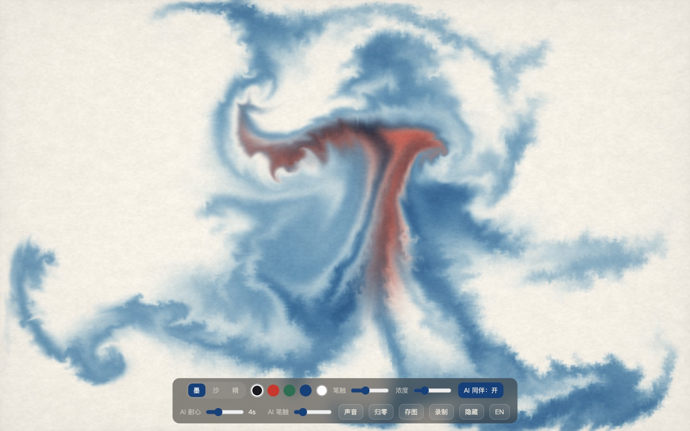
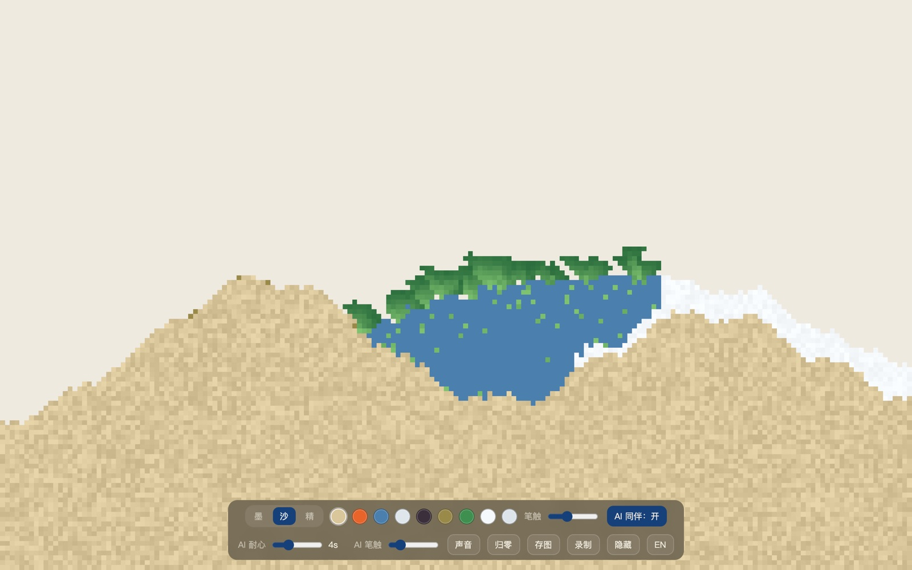
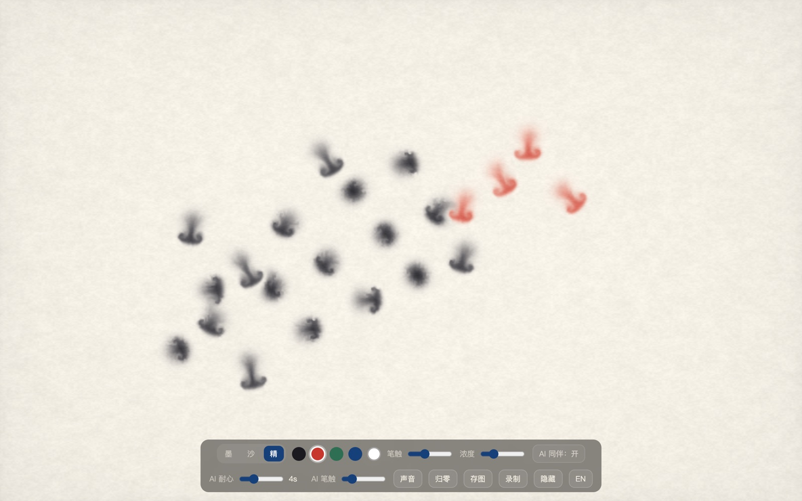

# Sand-and-Ink

A **fully offline, account-free, privacy-first** sandbox for unwinding. One canvas, two materials — switch with the 墨/沙 (Ink/Sand) toggle. No scores, no levels, no way to fail; everything runs 100% offline in your browser.

## Contents
- [Modes](#modes)
- [Screenshots](#screenshots)
- [How it works](#how-it-works)
- [Run it](#run-it)
- [Verify it](#verify-it)
- [Controls](#controls)
- [Design principles](#design-principles)
- [Credits & license](#credits--license)
- [Ideas for later](#ideas-for-later)
- [If you're struggling](#if-youre-struggling)

## Modes
- **Ink (Mode B)** — drop ink on water and watch it bleed.
- **Sand (Mode A)** — a falling-sand sandbox with 9 materials.
- **Fine art** — the AI steps aside completely; a finer brush and far less spread, so lines stay where you put them. What you painted in ink stays on the paper when you switch; press **Clear** for a fresh piece.

## Screenshots

| Ink | Sand | Fine art |
| :--: | :--: | :--: |
| [](docs/screenshots/ink.jpg) | [](docs/screenshots/sand.jpg) | [](docs/screenshots/fine.jpg) |
| Ink keeps bleeding on its own, and the AI companion adds a stroke now and then | Pick from 9 materials and pour; sand settles, water pools, seeds sprout | The AI steps aside; finer brush, far less spread, lines stay put |

All three are screenshots directly from the website, not made-up ones.

## How it works

- **Ink mode**: you paint on the paper and the ink keeps bleeding on its own. A quiet "dumb AI" companion occasionally adds a stroke of its own — but the moment you touch the canvas it steps aside, and its next stroke avoids where you just painted. Your brush always wins.
- **Sand mode**: pick a material and pour it onto the canvas — sand / fire / water / cloud / bomb / seed / plant / snow / steam — and watch them fall, rise, flow, and react. The same AI companion quietly pours a little pile and stops as soon as you draw.

> This is the first minimal slice of IDEAS.md #001 ("offline sandbox healing tool"):
> ink fluid + dumb AI + interrupt/yield rules. **No machine learning involved.**

## Run it

**Desktop**: download the installer from [Releases](https://github.com/Franky100-pig/Sand-and-Ink/releases) — `.dmg` for macOS (Apple Silicon & Intel), `.exe` for Windows. Same offline sandbox in a small Electron shell.

**Browser**: double-click `index.html`. Every asset is local — zero network requests.

**PWA**: "Add to Home Screen" / "Install"; opens full-screen and works offline.

If your browser restricts `file://`, serve locally (still offline):

```bash
python3 -m http.server 8080
# open http://localhost:8080
```

## Verify it

Open `selftest.html` — two groups of checks (Ink 8, Sand 22) show PASS/FAIL. All green = both engines and the interrupt/yield rules are alive.

**Prove it's offline**: turn off Wi-Fi → open `index.html` → paint. Still works = offline confirmed. Or DevTools → Network → check **Offline** → reload; the request list shows only local files, zero external domains.

## Controls

- **Paint**: press and drag; ink keeps drifting after release.
- **Ink colors**: five dots (pine soot / vermilion / pine needle / AI blue / **white**). White lightens/fades ink back to paper.
- **Brush**: ink volume (also affects spread/flow).
- **Concentration**: ink darkness only, applied instantly to the whole sheet.
- **AI companion / patience**: on = paints when you're quiet; steps away the moment you draw. Patience = wait between strokes.
- **Soundscape**: cycles off → rain → tide; synthesized live, 100% offline. Default off.
- **Clear / Save / Save Movie**: Clear empties the paper; after clearing it becomes **Undo** for 10 seconds (no countdown) — click it to bring the painting back. Save exports PNG; Save Movie records ~15s (MP4, falls back to WebM).
- **Hide (C)**: hides the toolbar; back with C or Esc.
- **Keyboard**: `1`/`2`/`3` switch Ink/Sand/Fine · `S` save · `R` clear (undoable) · `M` record · `[`/`]` brush size · `C` hide / `Esc` show.

### Sand mode
- **Ink / Sand / Fine**: segmented button swaps the five ink dots for nine material dots; physics switches fluid ↔ cellular automaton.
- **Materials**: sand / fire / water / cloud / bomb / seed / plant / snow / steam — each with Powder Game–style reactions (fire burns out, water douses, seeds sprout, snow piles, steam condenses back to water).
- **AI**: same yield rules; holds back when the box is >~35% full.
- **Concentration** slider hides in sand mode.

## Design principles

- No scores/levels/failure. Fire/bombs are *physics*, never "win/lose".
- AI produces only *intent* (where to drop, how wet); the stroke belongs to the physics.
- No psychological assessment or "your drawing means X". This is a toy, not therapy.

## Credits & license

- `lib/suminagashi.js`: adapted from a third-party MIT engine (© 2026 Fisher). See [NOTICE.md](NOTICE.md).
- `lib/three.min.js`: three.js r137 (MIT).
- `lib/sandsim.js`: original in this repo (© 2026 Franky100-pig, MIT).

## Ideas for later

- The AI's ink **physically retreats** when the user paints (inject reverse velocity, not just "no new strokes").
- Upgrade the dumb AI to a sketch-RNN-style stroke-sequence model (still optional, still offline).

## If you're struggling

> 这是一个玩具，不是治疗，它不能替代专业帮助。如果你或身边的人正处于危机中，请主动求助——和受过训练的人聊聊，往往比想象中更有用。下面的热线都是免费且保密的。
>
> If you or someone you know is in crisis, please reach out. This is a toy, not therapy, and it cannot replace professional help. The lines below are free and confidential. **If there is immediate danger to life, call your local emergency number first.**

| Region / 地区 | Hotline / 热线 | Hours / 服务时间 |
| :-- | :-- | :-- |
| 中国大陆 | 全国心理援助热线 **12356**；北京心理危机研究与干预中心 **010-82951332**（手机）/ **800-810-1117**（座机）；希望24热线 **400-161-9995** | 24 小时 |
| 中国香港 | 香港撒瑪利亞防止自殺會 **2389 2222**；撒瑪利亞會 **2896 0000**；生命熱線 **2382 0000**；東華三院芷若園 **18281**；情緒通 **18111** | 24 小时 |
| 中国台湾 | 安心專線 **1925**；生命線 **1995**；張老師 **1980** | 24 小时（1980 周一至周六） |
| 中国澳门 | 社會工作局輔導熱線 **2826 1126**；明愛生命熱線 **2852 5222**；心晴熱線 **2871 2356** | 24 小时 |
| United States | **988** Suicide & Crisis Lifeline（call or text） | 24/7 |
| United Kingdom | Samaritans **116 123** | 24/7 |
| Canada | **988**（call or text） | 24/7 |
| Australia | Lifeline **13 11 14** | 24/7 |
| Japan | よりそいホットライン **0120-279-338**；#いのちSOS **0120-061-338** | 24 小时 |
| Germany | TelefonSeelsorge **0800 111 0 111** / **0800 111 0 222** / **116 123** | 24/7 |
| France | **3114**（prévention du suicide） | 24/7 |

Numbers were verified in October 2026 from each service's official source.
Hotlines change, so treat this as a starting point and look up the current line
for your area if a number doesn't connect.
